<h1 align="center">MiniPong with CNNs and reinforcement learning</h1>

  <b>CNNs that read ball and paddle positions off a tiny Pong screen, and agents that learn to keep the ball in play.</b> 
  A PyTorch notebook: CNN classifiers, a convolutional autoencoder and a CNN regressor on 676 training and 169 test
  screenshots of a 15 × 15 Pong field, then tabular SARSA, a Q-network and an actor-critic agent playing the game.

  
  
  
  

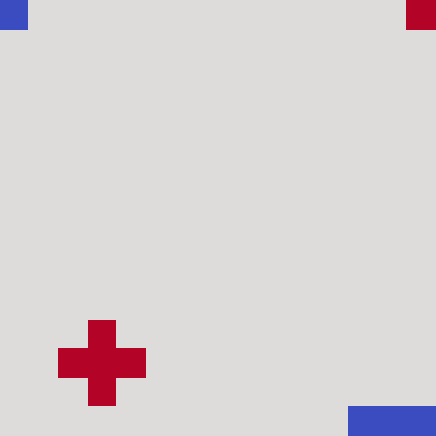

<i>The Bonus 2 actor-critic agent playing one level-3 episode after training: the ball comes off the paddle 15 times before it gets past. All 354 frames rendered in cell 80.</i>

  <a href="#results">Results</a> ·
  <a href="#method">Method</a> ·
  <a href="#data">Data</a> ·
  <a href="#repository-contents">Repository contents</a> ·
  <a href="#reproduce">Reproduce</a> ·
  <a href="#context">Context</a> ·
  <a href="#notes-and-limitations">Notes</a>

---

## At a glance

| Task | Question | Method | Headline result |
|---|---|---|---|
| 1 | Which column is the ball in? | CNN classifier, 2 conv + 3 dense layers | Test accuracy 1.00 on 169 images |
| 1 | Ball column, ball row and paddle slot from one network? | Multi-output CNN, three softmax heads | Accuracy 0.98 (x), 0.90 (y), 0.06 (z) |
| 2 | Can a 225-pixel frame pass through a 128-value code? | Convolutional autoencoder | Test MSE 0.0004; 0.0183 on noisy inputs |
| 3 | Can an agent play level 1, seeing only dz? | Tabular SARSA; Q-network | Test-Average 58.24 ± 53.87; 152.88 ± 163.56 |
| 4 | Can it play level 3, seeing y, dx and dz? | Actor-critic, 128 hidden units | Running reward past 300 (309.77) in 13 min; Test-Average 227.76 ± 185.17 |
| Bonus 1 | Can dz be read straight from the pixels? | CNN regressor | Test MSE 0.0552 |
| Bonus 2 | What changes if needless paddle moves cost reward? | Same actor-critic design, reshaped reward | Running reward past 300 (355.56) in 2 min; Test-Average 263.88 ± 219.38 (new reward scale) |

Test-Average ± SD is the mean and standard deviation of the total reward over 50 test episodes. In the original
environment each return of the ball scores 13.

## Results

### Playing MiniPong

| Task | Agent | Level | Training | Test-Average ± SD |
|---|---|---|---|---|
| 3A | Tabular SARSA, 27 dz bins | 1 | 1,000 episodes | 58.24 ± 53.87 |
| 3B | Q-network, 64 hidden units | 1 | 3,000 episodes | 152.88 ± 163.56 |
| 4 | Actor-critic | 3 | more than 8,000 episodes (13 min) | 227.76 ± 185.17 |
| Bonus 2 | Actor-critic, reshaped reward | 3 | more than 2,500 episodes (2 min) | 263.88 ± 219.38 |

At level 1 the agent sees only dz, the ball's horizontal offset from the paddle centre. The Q-network agent scored
higher than tabular SARSA, with a wider spread between episodes. Both were tested greedily; the actor-critic agents
sampled their actions from the learned policy.

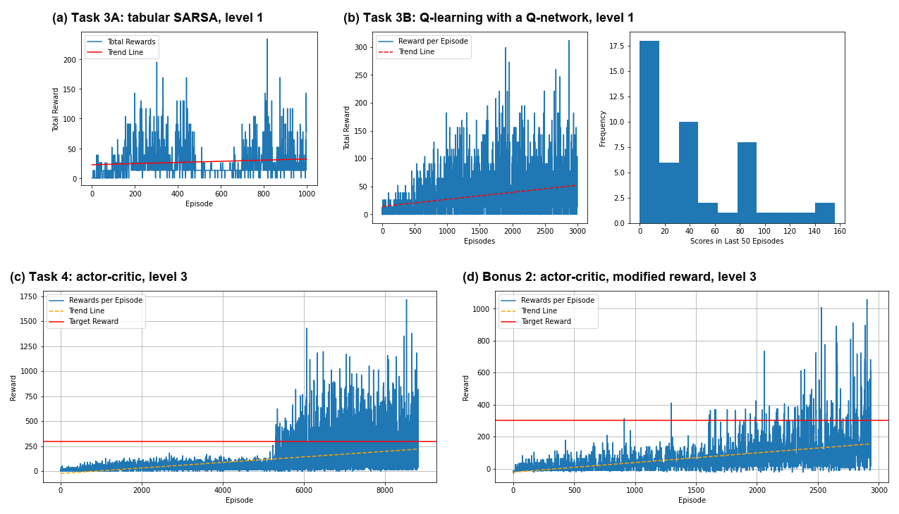

<i>Total reward per training episode, as plotted in cells 51, 61, 69 and 80 (new headings). The red line in (c) and (d) marks the running-reward target of 300.</i>

The level-3 actor-critic learned slowly at first (panel c): the running reward was 43.53 at episode 5,000 and 226.56
at episode 6,000. With the [reshaped reward](#bonus-2-reshaping-the-reward) of Bonus 2 (panel d), where a return pays
26 instead of 13, a new network of the same design reached the target much sooner; its test score is on that scale.

### Reading the screen

The x-only CNN put all 169 test images in the right column. It was slow to start: the average training loss was
2.553 at epoch 100, close to the uniform-guess loss ln 13 ≈ 2.565, then 0.042 at epoch 200 and 0.004 at epoch 300.

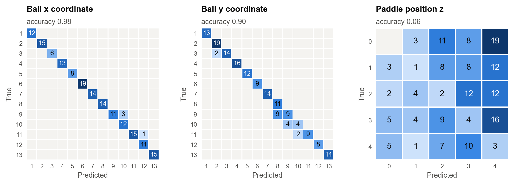

<i>Multi-output CNN on the 169 test images, re-drawn from the confusion matrices printed in cell 31.</i>

The multi-output CNN read ball x and y well (0.98 and 0.90), with every x or y error one position off, but its
paddle head did not learn (0.06 over five slots). The notebook concludes that cross-entropy classification was not
optimal, that more epochs did not help, and that regressing each coordinate and rounding at .5 would suit the task
better.

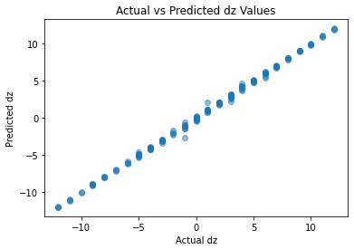

<i>Bonus 1: predicted against actual dz on the test images, as plotted in cell 77.</i>

For Bonus 1 a separate CNN regressed dz straight from the frame, with a test MSE of 0.0552.

### Compressing the screen

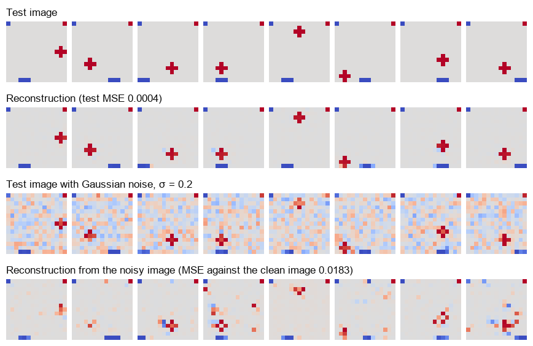

<i>Eight test images, clean and noisy, with their reconstructions. Panels cut from the plots in cells 41 and 43, with row headings added.</i>

The autoencoder squeezed each 225-pixel frame into a 128-value code and rebuilt it with a test MSE of 0.0004. With
Gaussian noise (σ = 0.2) on the test inputs, the MSE against the clean images rose to 0.0183; the paddle and most
balls survive, with some leftover speckle.

More figures from the notebook

 

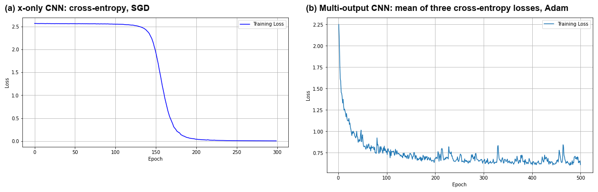

<i>Training loss of the two Task 1 CNNs (cells 21 and 30, as plotted).</i>

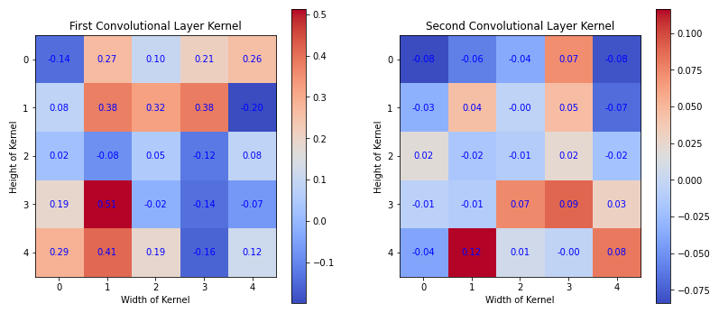

<i>First kernel of each convolutional layer of the trained x-only CNN (cell 25, as plotted).</i>

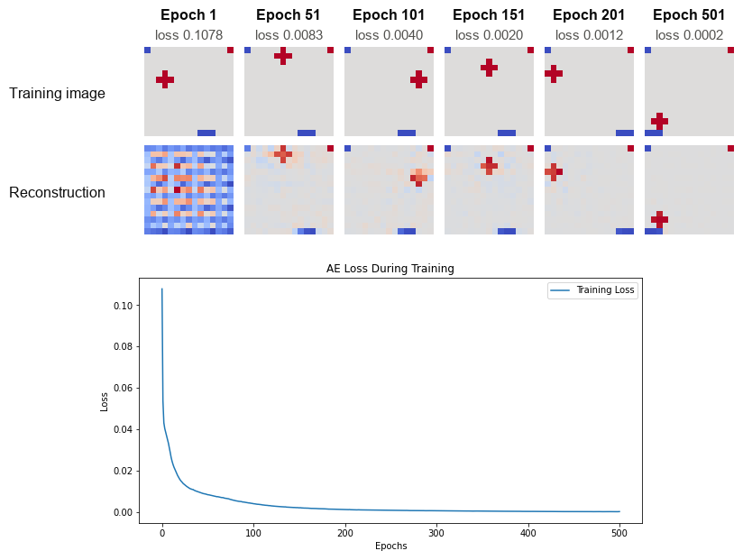

<i>Training images and their reconstructions at six epochs, with the printed loss, and the loss curve (cell 40).</i>

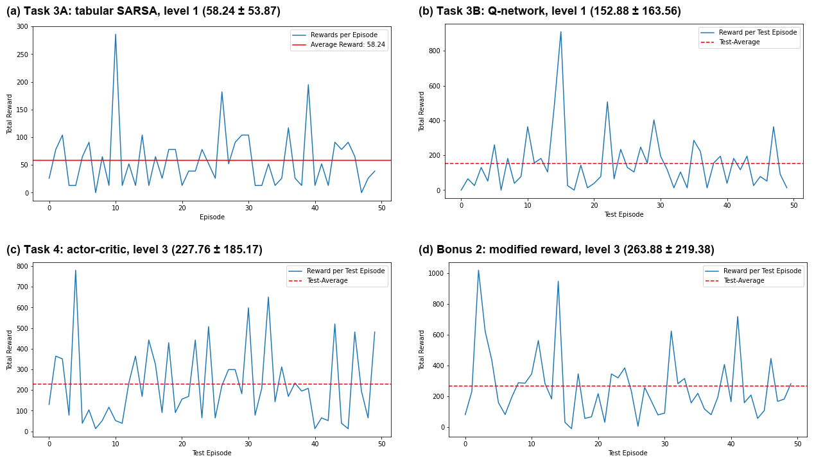

<i>Reward in each of the 50 test episodes (cells 55, 62, 70 and 81, as plotted), with the Test-Average ± SD in each heading.</i>

## Method

### Task 1: CNNs for ball and paddle positions

Images were reshaped to 1 × 15 × 15 and flipped vertically so the paddle row sits at the bottom, as in the game;
pixel values were not rescaled. Labels were one-hot encoded with scikit-learn's `OneHotEncoder`, and both networks
used batches of 32.

| | x-only CNN | Multi-output CNN |
|---|---|---|
| Layers | conv 6@5×5, max-pool, conv 16@5×5, max-pool, dense 120, 84, 13 | the same two conv blocks, conv 8@3×3 (8 values), dropout 0.1, dense 120, 84, then heads of 13, 13 and 5 |
| Loss | cross-entropy | mean of three cross-entropy losses |
| Optimiser | SGD, learning rate 0.001, momentum 0.9 | Adam, learning rate 5e-3 |
| Epochs | 300 (11.55 s) | 500 (37.19 s) |

### Task 2: convolutional autoencoder

| Part | Layers | Output |
|---|---|---|
| Encoder | conv 16@3×3 stride 2, ReLU, max-pool 2, conv 8@3×3, ReLU | 8 × 4 × 4 = 128 values |
| Decoder | transposed conv 16@3×3 stride 2, ReLU, transposed conv 1@3×3 stride 2, tanh | 1 × 15 × 15 |

Trained without labels on the 676 training images: MSE loss, Adam (learning rate 0.001), batches of 32, 501 epochs
(31.50 s).

### Tasks 3 and 4: the environment

`MiniPongEnv` (size 5, `normalise=True`) has three actions (stay, left, right), and the paddle moves one 3-pixel
slot per step. The ball moves diagonally and bounces off the walls and the paddle; the episode ends when it reaches
the bottom row past the paddle. Level 1 returns dz scaled to [−1, 1]; level 3 adds the ball's height y, scaled the
same way, and its last horizontal step dx, unscaled.

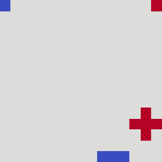

<i>Task 3, step 1: a rule-based player (left when dz &lt; 0, right when dz &gt; 0) scored 13 in this 45-step level-1 episode. All 45 frames rendered in cell 48.</i>

### Task 3: level 1 agents

| | 3A: tabular SARSA | 3B: Q-learning with a Q-network (`DQN` class) |
|---|---|---|
| State | dz binned into 27 rows | dz as one input |
| Model | 27 × 3 Q-table | dense 1 → 64 (ReLU) → 3 |
| Update | SARSA, α = 0.01, γ = 0.5 | one-step Q-learning target, MSE, Adam (learning rate 5e-3), γ = 0.99, one transition at a time, no replay buffer or target network |
| Exploration | ε-greedy, ε from 1.0, × 0.99 per episode, floor 0.1 | ε-greedy, ε from 0.99, × 0.97 per episode, floor 0.1 |
| Training | 1,000 episodes, 1.6 s | 3,000 episodes, 166 s |

### Task 4: actor-critic at level 3

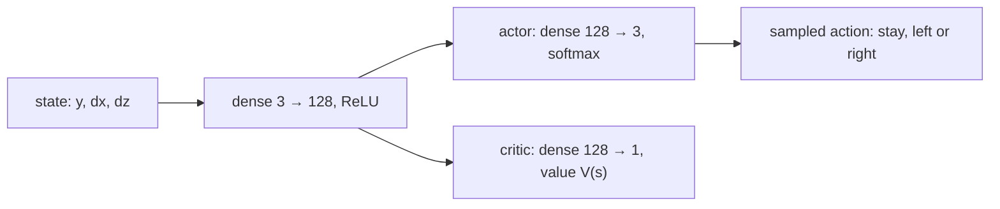

The policy was updated once per episode from Monte Carlo returns with γ = 0.95, standardised within the episode
($`\hat G_t`$), using

$$
L = \sum_t \Big[ -\log \pi(a_t \mid s_t) \big(\hat G_t - V(s_t)\big) + \mathrm{SmoothL1}\big(V(s_t), \hat G_t\big) \Big],
\qquad G_t = \sum_{k \ge 0} \gamma^k r_{t+k},
$$

where $`V(s_t)`$ is held fixed in the first term. Optimiser: Adam, learning rate 5e-3. The running reward,
$`0.05 \times \text{episode reward} + 0.95 \times \text{previous}`$, was logged every 1,000 episodes, and training
stopped once it passed 300.

### Bonus 1: dz from pixels

The target was dz = x − (3z + 1), the ball's column minus the paddle's centre column, computed from the Task 1
labels. The regressor (conv 16@3×3, max-pool, conv 32@3×3, max-pool, dense 120, one output) was trained with MSE,
Adam (learning rate 0.001) and batches of 32 for 200 epochs.

### Bonus 2: reshaping the reward

`ModifiedMiniPongEnv` subclasses the environment and replaces the reward to discourage needless paddle moves:

| Event | Original reward | Reshaped reward |
|---|---|---|
| Ball comes off the paddle | 13 | 13 + 13 = 26 |
| Ball gets past the paddle (episode ends) | 0 | −10 |
| Left or right move ending with the ball's x outside the paddle's three columns | 0 | −0.5 |
| Anything else | 0 | 0 |

A new actor-critic of the same design (γ = 0.95, learning rate 5e-3) was trained at level 3, logging every 500
episodes (running reward 123.03 at episode 2,500). The GIF at the top is the episode it played after training.

## Data

The supervised tasks use the MiniPong sprite dataset that the course's `sprites.py` writes as CSV files:
`trainingpix.csv` (676 images) and `testingpix.csv` (169), each row a 15 × 15 screenshot flattened row by row, with
(x, y, z) labels in `traininglabels.csv` and `testinglabels.csv`; `allpix.csv` and `alllabels.csv`, also loaded,
hold all 845. Pixels take the values −1, 0 and 1; x and y run from 1 to 13 and z from 0 to 4.

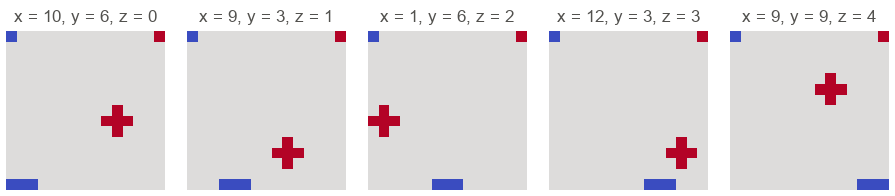

<i>One training image per paddle position z (cell 12, titles re-typeset): ball as a red plus, paddle as a blue bar, fixed markers in the top corners.</i>

The reinforcement-learning tasks use `MiniPongEnv` from the course's `mini_pong.py`, a gymnasium-style simulation of
the same field. Both files belong to the course, so they are not redistributed here; no licence is stated for them.
Running `sprites.py` generates the synthetic dataset locally.

## Repository contents

| Path | Contents |
|---|---|
| [`AML.ipynb`](AML.ipynb) | The whole assignment, from the data checks to both bonus tasks, with all outputs |
| `README.md` | This page |
| `docs/images/` | Figures for this page, cut from the notebook's outputs or re-drawn from values it prints |

Not included: the course files `mini_pong.py` and `sprites.py`, the CSV data that `sprites.py` produces, and the
files the notebook writes as it runs (`xPredict.csv`, `.pth` weights, `model_checkpoints/` and PNG copies of
plots).

## Reproduce

The notebook ran on Python 3.9.12 and imports `torch`, `torchvision`, `numpy`, `pandas`, `matplotlib`, `seaborn` and
`scikit-learn`; library versions are not recorded.

1. Get `mini_pong.py` and `sprites.py` from the course materials and put them next to `AML.ipynb`. Without them
   the notebook stops at its first code cell.
2. Run `python sprites.py` to create the CSV files that cell 9 loads.
3. Install the libraries above plus whatever `mini_pong.py` needs (the brief says it uses gymnasium), then run the
   notebook from the top.

Caveats:

- Newer scikit-learn releases rename the `OneHotEncoder` argument `sparse` to `sparse_output` (cell 15 notes this).
- No random seeds are set, so retrained numbers will differ, the reinforcement-learning ones most of all.
- The actor-critic runs train until the running reward passes 300, so their length varies between runs.

## Context

Individual assignment for *Advanced Machine Learning* at Western Sydney University, 2024 (the MiniPong assignment).
The environment, the dataset script and the task descriptions in the notebook's markdown cells come from the
assignment brief.

## Notes and limitations

- Each result comes from a single run, with test standard deviations of the same order as the means, so differences
  between agents are indicative rather than firm.
- The Bonus 2 scores are on a different reward scale from Task 4 and do not compare directly with it.
- The autoencoder was trained on clean images only, so the noisy-input MSE shows how it copes with noise it has not
  seen; it is not a trained denoiser.
- The course files `mini_pong.py` and `sprites.py` are not included (see [Reproduce](#reproduce)).
